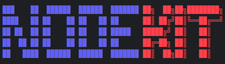

## nodekit upgrade

Upgrade the node daemon

### Synopsis

                                                                   
            
                                                                   
                                                                   
Upgrade the node daemon                                            
                                                                   
Overview:                                                          
Upgrade Algorand packages if it was installed with package manager.
                                                                   
This requires the daemon to be installed on your system.           

```
nodekit upgrade [flags]
```

### Options

```
      --accept-new-key   install a new Algorand package signing key without asking
  -h, --help             help for upgrade
```

### SEE ALSO

* [nodekit](/README.md)	 - Manage Algorand nodes from the command line

